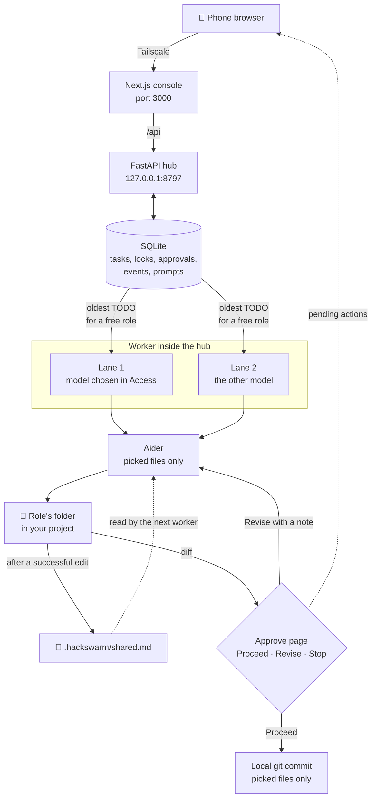

# Agent team

A small coding team that runs on your own computer and answers to your phone.

You send a task from your phone's browser. One of three roles (**UI**, **API**, or **Review**) picks it up, runs [Aider](https://aider.chat/) on the files you picked in that role's folder, and stops before anything that is hard to undo. You read the log and approve or refuse from the same phone. [Tailscale](https://tailscale.com/) is the private path between the phone and the computer. Nothing is hosted in the cloud, and nothing is pushed to a remote.

This repository started as a fork of [HackSwarm](https://github.com/TalenMud/ai-hacktoberfest-project), a Hacktoberfest scaffold for a team of developers sharing one AI hub. This version is narrowed to one person, one computer, and a phone.

---

## Contents

- [Is it a swarm?](#is-it-a-swarm)
- [How a task moves](#how-a-task-moves)
- [The three roles](#the-three-roles)
- [What changed from the fork](#what-changed-from-the-fork)
- [Built with](#built-with)
- [Repository map](#repository-map)
- [Set it up](#set-it-up)
- [Use it from your phone](#use-it-from-your-phone)
- [Approval levels](#approval-levels)
- [Models](#models)
- [Known limits](#known-limits)

---

## Is it a swarm?

**Not in the full sense.** It is a coordinated team of up to two workers at a time, with you as the dispatcher.

What it does today:

- Three role queues share one hub. Each role has its own folder, its own built-in brief, and an extra prompt you can edit from the phone.
- Two tasks for two different roles can run at the same time. One runs on Gemini and the other on the local Ollama model.
- The workers do not overwrite each other. Each task locks its files, git commits take turns, and a finished edit appends a line to `.hackswarm/shared.md`. The next worker reads that note before it edits.
- Each worker waits for your approval on its own. Approving one does not hold up the other.

What a swarm would also do, and this does not:

- **No agent talks to another agent.** They coordinate through the shared note and file locks, not by messaging each other.
- **No planner splits a task.** One task goes to one role. You decide which role gets what.
- **No automatic handoff.** Review does not start by itself when UI or API finishes. You queue it.
- **No more than two at once.** A third task waits for a free lane.
- **The roles are prompts, not separate models.** All three roles run Aider. What differs is the folder and the instructions.

### Why it stops there

| Reason | Effect |
| --- | --- |
| A 6 GB laptop GPU fits one small local model (`gemma3:4b`). | Only one local worker at a time. |
| There is one Gemini key. | Only one cloud worker at a time. |
| A worker keeps its lane while it waits for you to approve. | Two waiting tasks fill both lanes, and the next task waits for one of them. |
| The fork's multi-machine swarm was never wired up. `teammate_client/client_agent.py` only prints the commands it would run, and its `claim_task` always returns true. `central_hub/mcp_server/` is plain Python helpers over SQLite, not a running MCP server. LangChain and ChromaDB were never in `requirements.txt`. | Nothing from the fork connects other laptops or agents to this hub. |
| This fork is for one person away from the desk. | Simple, predictable queues and an approval step were chosen over agents that decide among themselves. |
| Cursor's open agent tabs cannot be driven from outside. | Cursor stays the desk tool. The phone team runs Aider. |

---

## How a task moves



1. **Queue.** On the **Team** page you choose a role, pick the files it should change inside that role's folder, and describe the change. You can send a second task to a different role at the same time. Each task is stored as `TODO`.
2. **Claim.** When a lane is free, the worker claims the oldest task whose role is not already busy. It records which model the task uses and locks the picked files. Another task that needs one of the same files waits.
3. **Brief.** The message to Aider is built in this order:
   1. `HACKSWARM.md` from the project folder, first 4,000 characters, if the file exists
   2. the role's built-in brief
   3. your extra prompt for that role, from the **Prompts** page
   4. the task text
   5. the last 2,000 characters of `.hackswarm/shared.md`
   6. any Revise notes
4. **Edit.** Aider runs with `--subtree-only --map-tokens 0 --no-auto-commits` inside the role's folder. It reads and changes only the picked files, and can create a new file you named. It does not build a map of the whole repository. If Aider fails, the task is marked failed and the files are left as they were.
5. **Gates.** Before each step, the worker checks your approval level. A step either runs, runs and tells you, waits on **Approve**, or is refused. See [Approval levels](#approval-levels).
6. **Share.** After a successful edit, the worker appends one line to `.hackswarm/shared.md` at the git root, saying which role finished what and which files it touched.
7. **Review the change.** The commit step waits on **Approve** with the real diff of the picked files, and the first 40 lines of any new file. Choose **Proceed** to commit, **Revise** with a note to send it back to Aider, or **Stop** to leave the files uncommitted.
8. **Commit.** The worker, not Aider, commits only the picked files. Anything else you had staged stays staged. Commits in the same repository take turns.
9. **Done.** Marking the task done releases its locks. Push is never offered.

The **Log** page streams every step from the hub, and the optional `NTFY_TOPIC` sends a phone notification when something waits on you or a task finishes.

---

## The three roles

Each role is tied to one folder. That folder is where the role's files live and the only place its changes can land. You set it once in **Access**, and the file picker on **Team** opens inside it.

| Role | Its job | Built-in brief |
| --- | --- | --- |
| **UI** (Interface) | Screens, components, styles, and client-side calls. | Change layout, copy, and client behavior inside the locked files. Do not touch the server, the database, or secrets. |
| **API** (Services) | Routes, handlers, data access, and server logic. | Change handlers, routes, and data access inside the locked files. Do not restyle the interface or touch secrets. |
| **Review** | Fixes what broke after UI or API changed something. | Read the shared note, then fix breaks inside the locked files. Do not widen the task or rewrite the other role's work. |

### Where each role's folder usually is

Point each role at the folder below inside your project, not at the project root. A role pointed at the root can be handed files from anywhere in the tree, which defeats the split.

| Project layout | UI folder | API folder |
| --- | --- | --- |
| Vite or Create React App with a separate server (Trail Sketch) | `src` | `server` |
| Next.js App Router | `app` (and `components` if it is separate) | `app/api` or `lib` |
| Next.js Pages Router | `pages` or `src/pages` | `pages/api` |
| Monorepo | `apps/web/src` or `packages/ui` | `apps/api/src` or `services/<name>` |
| Front end and back end side by side | `frontend/src` or `client/src` | `backend` or `server` |
| Django | `templates` and `static` | the app folder with `views.py` and `models.py` |
| FastAPI or Flask with a separate front end | the front end's `src` | `app` or `api` |

For **Review**, use the folder that was just changed. After a UI task, that is the UI folder. After an API task, it is the API folder. Change it in **Access** before you queue the review.

For Trail Sketch on this machine:

| Role | Folder |
| --- | --- |
| UI | `D:\Documents\vscode\trail-sketch\src` |
| API | `D:\Documents\vscode\trail-sketch\server` |
| Review | whichever of those two was just edited |

Shared types between the two folders, such as `trail-sketch\shared`, are outside both roles. Change them at the desk, or point one role at the project root for that one task.

---

## What changed from the fork

| From HackSwarm | Here |
| --- | --- |
| Aider runner (`teammate_client/aider_runner.py`) | **Kept.** It is the only code editor the worker uses. Locked to Python 3.12 and `aider-chat 0.86.2`. |
| SQLite task board and file locks (`central_hub/mcp_server/server.py`) | **Kept and extended** with approvals, policy, PIN sessions, events, role prompts, per-task model lanes, and the folder and file browsers. |
| Tailscale as the network | **Kept**, but only the phone uses it, and only to reach port 3000. |
| Ollama for local models | **Kept** as the second lane. The model is now `gemma3:4b`. |
| Pixel desk picture (`central_hub/dashboard/visualizer.html`) | **Kept as a file**, not used. It is a simulation, not the live console. |
| FastMCP server, LangChain client agents, ChromaDB memory | **Never running.** The folder name `mcp_server` is left over from the fork. |
| Free-model router (Groq, Mistral, OpenRouter, NVIDIA NIM) | **Present, not used.** The worker only runs Gemini or Ollama. |
| OpenCode and OpenHands runners | **Present, not used.** |
| Streamlit dashboard idea | **Replaced** by the Next.js phone console. |
| Several developer laptops calling one hub | **Replaced** by one computer and one phone. |
| *(new)* | Phone console, PIN sign-in, approval queue with diffs, policy presets, live log, role prompts, file picker, two-lane worker, shared change note. |

---

## Built with

| Layer | Technology |
| --- | --- |
| Phone console | [Next.js 16](https://nextjs.org/) (App Router), React 19, TypeScript, plain CSS |
| Hub | [FastAPI](https://fastapi.tiangolo.com/), [Uvicorn](https://www.uvicorn.org/), Pydantic |
| Storage | SQLite in WAL mode (`central_hub/database/swarm.db`, created on first start) |
| Live log | Server-sent events (`/api/events`) with a polling backup |
| Code edits | [Aider](https://aider.chat/) `0.86.2` on Python 3.12 |
| Models | Gemini `gemini-3.8-flash` via [Google AI Studio](https://aistudio.google.com/), or [Ollama](https://ollama.com/) `gemma3:4b` |
| Network | [Tailscale](https://tailscale.com/), phone to computer only |
| Notifications | Optional [ntfy](https://ntfy.sh/) topic |
| Tests | pytest (`tests/`) |

---

## Repository map

```text
agent-team/
├── apps/console/              Phone console (Next.js)
│   ├── app/page.tsx           Team: roles, send one or two tasks
│   ├── app/file-picker.tsx    Browse and pick files inside a role's folder
│   ├── app/tape/page.tsx      Log: live events
│   ├── app/gate/page.tsx      Approve: every pending action
│   ├── app/steer/page.tsx     Prompts: extra prompt per role
│   ├── app/settings/page.tsx  Access: model, approval level, folders
│   └── next.config.ts         Proxies /api to the hub
├── central_hub/
│   ├── api/app.py             FastAPI routes, PIN session, starts the worker
│   ├── api/policy.py          Watch / Routine / Open presets
│   ├── mcp_server/server.py   SQLite store: tasks, locks, approvals, events
│   ├── worker/runner.py       Two-lane worker, role briefs, gates, commits
│   ├── llm_router/            From the fork, not used
│   └── dashboard/             From the fork, not used
├── teammate_client/
│   ├── aider_runner.py        Builds and runs the Aider command
│   └── client_agent.py, opencode_runner.py, openhands_runner.py
│                              From the fork, not used
├── tests/                     pytest
├── APPROVALS.md               What waits for approval, and why
├── .env.example               Copy to .env
└── requirements.txt           Hub packages and aider-chat
```

---

## Set it up

These steps are for Windows and PowerShell. Every step is required unless it says optional.

In Git Bash, write paths with forward slashes, for example `.venv/Scripts/python`. Bash reads a backslash as an escape character, so `.venv\Scripts\python` turns into `.venvScriptspython`.

### 1. Install the programs

| Program | Why | Check |
| --- | --- | --- |
| [Git for Windows](https://git-scm.com/download/win) | Aider and the worker use Git. | `git --version` |
| [Python 3.12](https://www.python.org/downloads/windows/) | Aider does not install on 3.13. Or `winget install --id Python.Python.3.12 -e`. | `py -3.12 --version` |
| [Node.js 20 LTS](https://nodejs.org/) or newer | Runs the phone console. Or `winget install --id OpenJS.NodeJS.LTS -e`. | `node -v` |
| [Tailscale](https://tailscale.com/download) | Install it on the computer and the phone, signed into the same account. | `tailscale ip -4` |
| [Ollama](https://ollama.com/download), optional | Needed for the second lane and for local-only work. | `ollama list` |

### 2. Clone

```powershell
git clone https://github.com/AbisoyeOnanuga/agent-team.git
cd agent-team
```

### 3. Create `.env`

```powershell
copy .env.example .env
```

Open `.env` and set:

| Variable | Value |
| --- | --- |
| `CONSOLE_PIN` | The PIN you type on the phone. Replace `change-me`. |
| `GEMINI_API_KEY` | A key from [Google AI Studio](https://aistudio.google.com/app/apikey). Leave it unset to run on Ollama only. |
| `HACKSWARM_PROVIDER` | `gemini` or `ollama`. The default for the first lane. **Access** overrides it once you choose. |
| `HACKSWARM_REPO_ROOTS` | Optional. Folders the roles may be pointed at, separated by `;`, for example `D:\Documents\vscode`. |
| `HACKSWARM_WORKSPACE` | Optional. Where the folder browser in **Access** starts. The default is `D:\Documents\vscode`. |
| `NTFY_TOPIC` | Optional. An ntfy topic for phone notifications. Treat it like a password. |

Leave `HACKSWARM_WORKER=1` and `CONSOLE_SECURE=0`. `.env` is gitignored. Do not commit it.

### 4. Create the Python environment

```powershell
py -3.12 -m venv .venv
.venv\Scripts\python -m pip install -r requirements.txt
```

This installs the hub and `aider-chat` into `.venv`. The first run takes a few minutes. Do not copy a `.venv` folder from another computer.

For the local lane:

```powershell
ollama pull gemma3:4b
```

### 5. Install the console

```powershell
cd apps\console
npm install
cd ..\..
```

### 6. Start the hub

Keep this window open. The worker runs inside this process.

```powershell
.venv\Scripts\python -m uvicorn central_hub.api.app:app --host 127.0.0.1 --port 8797
```

The hub listens only on this computer. Do not port-forward 8797.

If the PIN in `.env` is ignored, an old `CONSOLE_PIN` is set in the shell. Run `Remove-Item Env:CONSOLE_PIN` in PowerShell, or `unset CONSOLE_PIN` in Git Bash, then start the hub again.

### 7. Start the console

In a second window:

```powershell
cd apps\console
npm run dev
```

This listens on port 3000. Do not port-forward it either.

### 8. Open it

| Where | Address |
| --- | --- |
| This computer | [http://127.0.0.1:3000](http://127.0.0.1:3000) |
| Phone | `http://<tailscale-ip>:3000`. Get the address with `tailscale ip -4`. |

Sign in with your PIN. Eight wrong attempts within 15 minutes lock sign-in.

The phone works only while both windows are running and the computer is awake. Closing the browser tab on the computer does not affect the phone.

---

## Use it from your phone

The bottom bar has five pages.

| Page | What you do there |
| --- | --- |
| **Home** | See each teammate and send a job. Choose files from a phone-friendly sheet. Add a second job when you want two at once. |
| **Activity** | Live feed of what they are doing. |
| **Review** | Pause points with the diff. Looks good / Change it / Stop. |
| **Guide** | Extra standing notes for each teammate. |
| **Setup** | Free or Scale, privacy, brains, safety level, and folders (Browse sheet, not typing). |

**Stop** parks a task and releases its locks so it does not restart by itself. A failed step marks the task failed for the same reason.

---

## Approval levels

These are enforced by the worker, not by the model's prompt. The full table is in [`APPROVALS.md`](APPROVALS.md).

| Action | Watch | Routine | Open |
| --- | --- | --- | --- |
| Read the folder | runs | runs | runs |
| Edit locked files | waits | runs | runs |
| Format check, tests | waits | runs (tests notify you) | runs (tests notify you) |
| Commit | waits | waits | runs and notifies you |
| Delete, install | waits | waits | waits |
| Mark done | waits | waits | waits |
| Push, edit outside the lock, touch secrets | never | never | never |

Unanswered approvals stay pending. Silence never counts as Proceed.

To review every code change on your phone before it is committed, use **Routine**. In **Open**, commits land without waiting, and you only see them in **Log**.

---

## Free and Scale

| Plan | What you get |
| --- | --- |
| **Free** | Three teammates (UI, API, Review). Two jobs at once: Gemini and local Ollama. Lowest spend. |
| **Scale** | Same teammates, wider capacity. One cloud account you already pay for, plus local for private work. |

Scale width (pro-dev style: a few parallel jobs day-to-day; more only when folders are already split):

| Width | Jobs at once | Fit |
| --- | --- | --- |
| **Team** | up to 6 | Daily burst |
| **Swarm** | up to 12 | Big feature, split folders |
| **Project** | up to 24 | Large push, partitioned work |

Spend hint in Setup compares Scale to Free. Cheap hubs (Gemini / OpenRouter) can lower cost per open job; idle lanes still burn quota. Privacy: **Private first**, **Share the load**, or **Cloud first**. Keys stay on this PC (Windows DPAPI when available).

Pick Free or Scale in **Setup**. Scale is bring-your-own-key.

## Models

A lane is a model slot, not a role. The roles are the queues. With one model available, the roles take turns on it.

| Lane setup | What runs |
| --- | --- |
| Gemini key and Ollama running with `gemma3:4b` | Two lanes. The model chosen in **Access** takes the first task, and the other model takes the second. |
| Gemini key only | One lane. A second task stays queued until Gemini finishes the first, then Gemini takes it. |
| Ollama only | One lane, local and slower. Expect tens of seconds or more per edit on a 6 GB GPU. |
| Neither | One lane. Queues, log, and approvals still work. Edits are written as a dry-run note in `.hackswarm/dry-run.md`. Code files are not touched. |

The hub checks every 15 seconds whether Ollama is answering and has the model pulled. Start Ollama and the second lane opens by itself.

Cursor's Grok subscription is not an API key and does not drive this team. The Groq, Mistral, OpenRouter, NVIDIA, xAI, and Copilot entries left in `aider_runner.py` and `.env.example` are from the fork, and the worker does not select them.

---

## Known limits

- **You pick the files.** The model changes only the files you ticked or named. If the fix needs a file you did not pick, Revise and name it, or queue a new task with it.
- **Files outside a role's folder are out of reach.** Shared code between UI and API needs a task with a wider folder, or a change at the desk.
- **Two lanes at most.** A waiting approval keeps its lane busy.
- **Review is not automatic.** Queue it yourself after UI or API finishes.
- **Commits are local.** Push from the desk.
- **The hub must be restarted** after Python changes. The console reloads changes to its own pages.

### Run the tests

```powershell
.venv\Scripts\python -m pytest tests -q
```
